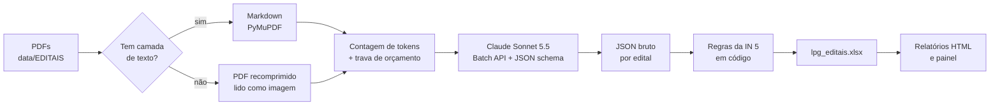
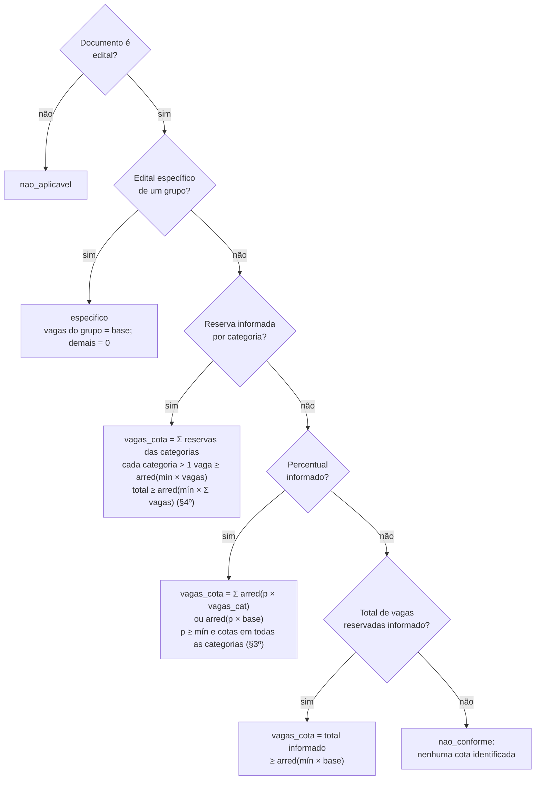
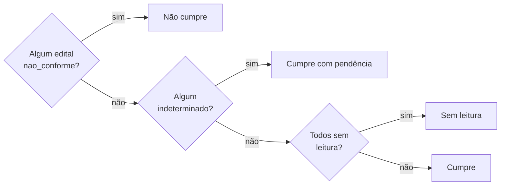
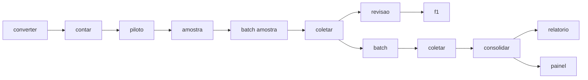

# Ações Afirmativas na Lei Paulo Gustavo

> Branch `lpg`: verificação das cotas nos editais de fomento dos Estados, DF e Capitais publicados com recursos da **Lei Complementar nº 195/2022 (LPG)**.

## Objetivo

Verificar se cada edital cumpre o art. 5º da [Instrução Normativa MinC nº 5/2023](https://www.in.gov.br/en/web/dou/-/instrucao-normativa-minc-n-5-de-10-de-agosto-de-2023-502407937):

| Regra | Conteúdo |
|---|---|
| caput | mínimo de **20%** das vagas para pessoas negras e **10%** para pessoas indígenas |
| §2º | fração ≥ 0,5 arredonda para cima; < 0,5 para baixo |
| §3º | edital com categorias deve ter cotas em **todas** elas |
| §4º | categoria com 1 vaga pode ir à ampla concorrência, se o edital somar 20% e 10% |

## Pipeline



1. **Conversão** (`extract/pdf_to_md.py`): cada PDF vira Markdown com marcador `<!-- página N -->`. PDFs escaneados (< 200 caracteres por página) são recomprimidos e enviados como PDF.
2. **Orçamento** (`llm/budget.py`): antes de enviar, conta os tokens exatos e calcula o pior caso. Se `gasto + reservado em batches abertos + pior caso > ORCAMENTO_USD`, nada é enviado.
3. **Extração** (`llm/`): o edital inteiro vai em uma única chamada, sem cortes. O modelo **só extrai** (com trecho literal e página como evidência); não calcula nem julga.
4. **Conformidade** (`transform/conformidade.py`): aplica as regras da IN 5 e classifica cada edital.
5. **Consolidação** (`transform/consolida_lpg.py`): gera a planilha final e marca para revisão editais em que o dicionário de termos (`dicionario_cotas.py`) acha menção a cota que o modelo não registrou.
6. **Avaliação** (`avaliacao.py`): gabarito manual de ~20% da base, estratificado por ente, com F1 por campo.

## Variáveis extraídas

Schema Pydantic em `src/llm/schema.py`. Todos os campos são obrigatórios e aceitam `null` quando a informação não está no edital.

| Grupo | Campos |
|---|---|
| Identificação | `tipo_documento` (edital, retificação, resultado, anexo, outro), `objeto`, `modalidade` (fomento, prêmio, bolsa, subsídio, outro), `area_cultural` |
| Tamanho | `valor_total`, `vagas_totais` |
| Categorias | `possui_categorias`, `categorias[]` (nome, vagas, valor por vaga, valor da categoria, vagas reservadas a negras, indígenas, PcD, LGBTQIA+ e quilombolas) |
| Cotas IN 5 | `percentual_negras`, `percentual_indigenas`, `vagas_negras_total`, `vagas_indigenas_total`, `cotas_por_categoria` (sim, não, não informado, sem categorias) |
| Edital específico | `edital_especifico_grupo` (grupo a que o edital inteiro se destina) |
| Outras ações | `outras_cotas[]` (PcD, LGBTQIA+, quilombolas, mulheres, povos tradicionais, pessoas idosas, território, outro; com percentual e vagas), `pontuacao_bonus[]` |
| Controle | `outros_editais_no_documento[]`, `observacoes`, `evidencias[]` (campo, trecho, página) |

### Saída: `data/final/lpg_editais.xlsx`

| Aba | Linha = | Conteúdo |
|---|---|---|
| `editais` | edital | campos acima + `cod_ibge`, vagas e valores calculados, status por grupo e geral, motivo, alertas de revisão |
| `categorias` | categoria | vagas, valores e reservas de cada categoria |
| `outras_cotas` | cota | grupo, percentual e vagas |
| `evidencias` | trecho | campo, trecho literal e página |

## Regras de cálculo

### Vagas reservadas por edital

`base = vagas_totais` ou, se ausente, a soma das vagas das categorias. Arredondamento sempre pelo §2º (`arredonda_in5`, meio para cima).



**Status por grupo** (negras e indígenas): `conforme`, `nao_conforme`, `indeterminado` (falta reserva em alguma categoria ou falta o total de vagas) ou `especifico`. Se o §3º não está explícito (`cotas_por_categoria = nao_informado`), o edital fica `conforme` com ressalva no motivo.

**Status do edital** (`status_in5`), pela ordem de prioridade:

```
especifico  >  nao_conforme  >  indeterminado  >  conforme
```

### Valores reservados por edital

$$\text{valor\_por\_vaga} = \frac{\text{valor\_total}}{\text{vagas\_totais}} \qquad \text{valor\_cota} = \text{vagas\_cota} \times \text{valor\_por\_vaga}$$

Sem vagas, usa-se `p_cota × valor_total`. Em edital específico do grupo, o valor reservado é o `valor_total`.

### Agregação por ente

Somam-se apenas os editais com vagas (ou valores) disponíveis:

$$p_{\text{vagas, ente}} = \frac{\sum \text{vagas\_cota}}{\sum \text{base}} \qquad p_{\text{valor, ente}} = \frac{\sum \text{valor\_cota}}{\sum \text{valor\_total}}$$

**Situação do ente** (por grupo e geral):



Editais fora do escopo (seleções de OSC e evento), definidos na revisão manual, ficam em `FORA_DO_ESCOPO` (`relatorio_cotas.py`) e são excluídos do relatório.

### Leitura dos resultados

Percentual agregado um pouco abaixo do mínimo não implica descumprimento: o arredondamento do §2º e os editais específicos (que concentram vagas em um grupo) alteram a proporção do conjunto.

## Como usar

```
python -m venv .venv
.venv\Scripts\activate
pip install -r requirements.txt
```

Crie `src/.env` com `ANTHROPIC_API_KEY=...` e rode a partir de `src/`:



| Comando | Faz |
|---|---|
| `python main.py converter` | PDF → Markdown + manifesto (local) |
| `python main.py contar` | tokens e custo estimado (gratuito) |
| `python main.py piloto 10` | extração síncrona de 10 editais variados |
| `python main.py amostra [n]` | sorteia a amostra do gabarito (padrão 20%) |
| `python main.py batch [amostra]` | envia batch de todos os pendentes ou só da amostra |
| `python main.py coletar` | coleta batches terminados |
| `python main.py consolidar` | aplica as regras e gera a planilha + dicionário de dados |
| `python main.py filtrada` | cópia da planilha sem os editais fora do escopo |
| `python main.py novos [enviar]` | estima custo / envia só os editais de `data/NOVOS` |
| `python main.py revisao` / `f1` | planilha do gabarito / cálculo do F1 |
| `python main.py relatorio` | relatório exploratório HTML |
| `python relatorio_cotas.py` | relatório de cotas HTML (`relatorios/`) |
| `python main.py painel` | painel em http://127.0.0.1:8050 |
| `python main.py gasto` | gasto acumulado |

Testes das regras: `pytest tests`.

## Estrutura

```
data/EDITAIS/{Capitais,Estados}/<ente>/*.pdf   # entrada
data/interim/LPG/                              # Markdown, manifesto, JSON bruto, gastos, batches
data/final/lpg_editais.xlsx                    # resultado
relatorios/                                    # relatórios HTML
src/main.py                                    # orquestrador
src/extract/  src/llm/  src/transform/         # etapas do pipeline
src/dashboard/                                 # painel Dash
tests/                                         # testes das regras de cota
```

## Licença

MIT.
